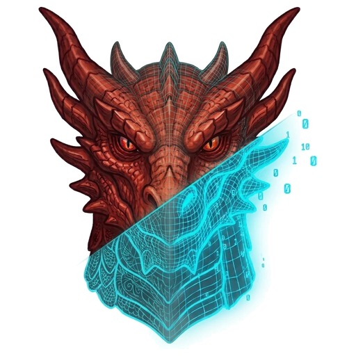

# StlArchivist

<p align="center"></p>

**StlArchivist** manages local collections of 3D-printable model archives. It scans folders of
`.zip`, `.7z` and `.rar` files, extracts metadata and thumbnails, and stores everything in a
library database so you can browse, search, tag and de-duplicate your collection without
unpacking anything.

It is a server (`stl-server`, Rust) with a web client (React) that runs in any browser, and
a small desktop app (`stl-desktop`, Tauri) that shows the same client in its own window and
can open a library on your computer without setting up a server.

**Guides:** [using StlArchivist](docs/user-guide.md) · [deploying a server](docs/deployment.md) ·
[the HTTP API](docs/api.md) ·
and in the interface, the **?** button: searchable in-depth help on every feature

Version: 2026.46.1

> The earlier PyQt6 desktop application lives on in the repository's history (and on its
> own branch). This version opens its data directory and, since 2026.43.7, converts it once
> to libraries with relative paths (backing it up first); the earlier application cannot
> open the converted library. Before that conversion it opened the same data directory
> (`stlLibrary.db`, `thumbnails.lmdb/`, `settings.json`). Since 2026.43.10 the model
> database is `models.db`; a data directory holding only `stlLibrary.db` opens as a new,
> empty library (crawl the folders again).

## Features

- **Archive scanning** — crawls folders of archives in parallel using CRC-based
  fingerprints (no decompression needed to notice what changed); moved archives keep their
  record, metadata and thumbnails, even when moved between libraries
- **Status bar** — the running job's progress and the number of archives catalogued, on
  every page
- **Libraries** — named collections of one or more folders (one library over several disks);
  records store paths relative to their folder, in a form that is the same on Windows, Linux
  and macOS, so a folder moves to another disk, mount point or machine (and from Windows to
  Linux) by pointing it at its new place — no re-crawl, nothing lost; folders can sit inside
  one another
- **Metadata extraction** — from `info.json` (in the archive, or beside a lone archive), `.url` files and the folder structure
  through [path patterns](#path-patterns)
- **Thumbnails** — up to N images per archive (JPEG; animated GIFs stay animated), stored
  once even when many archives share them; PDF previews with pdfium
- **Scale, presupport and warning detection** — scales such as `28mm`, `32mm`, `1/35` (a model
  can have several); Lychee / Chitubox / presupported STL detection; warnings for archives
  with presupported STLs, no images, no printable files, nested archives or (optionally) low compression, with *Warning
  details* showing which files trigger each and *Files* highlighting them; *Clear warnings* (right-click a row) dismisses
  false positives until the archive is rescanned
- **Browser** — faceted filters (include / exclude per value, has-value groups, counts, long
  lists grouped by first letter),
  search in chosen fields (optionally fuzzy: accents ignored, typos tolerated), a sortable virtualised table with in-place editing (suggesting the values in the library), selectable columns and
  (optionally) rows with warnings highlighted, paths relative to their library, links in the
  URL column, folders of the filter tree crawled or
  rescanned from their right-click menu, an
  image grid, a detail pane with thumbnails, downloads and image drag-and-drop, and a
  folder-by-folder archive browser
- **Editing** — model editor, mass editor (path patterns with a preview, find & replace, tags added or cleared,
  trimming), lookup editors for tags, categories, collections, subcollections, scales, sculptors, releases and
  creators, with *Merge similar* to find and join near-duplicate names
- **Duplicates** — archives sharing STL files, archives with similar images (perceptual hash
  or AI embedding, skipping banners shared by many archives), models with equal or similar
  metadata (exact, Levenshtein, Soundex), with side-by-side comparison and a button
  before each archive that deletes its file (to the trash folder when one is set)
- **Find by Image** — drop a picture to find models whose thumbnails look like it
- **AI tagger** — a local vision model through llama.cpp (Qwen3-VL 4B by default, or Qwen2.5-VL 3B; chosen in
  *Settings → Components*, any GGUF via `ai.model`), a free OpenRouter vision model, or any OpenAI-compatible
  endpoint (Gemini's `gemini-flash-lite-latest` by default), suggests tags, title,
  creator, sculptor, scale, source, year and description (never collection or subcollection); review one by one or
  tag a selection in one job
- **AI metadata check** — *Actions → AI metadata check…* lists problems the AI model sees in the selected models'
  metadata (implausible scales, misspelled names, mismatched titles) with the current and suggested values; ticked suggestions are applied in one click
- **AI fill and pattern in Mass edit** — *AI fill* saves AI data for the whole selection in one job; *Infer with AI*
  proposes the mass edit's path pattern from the selected models' paths
- **AI data** — in the model editor, the same model infers every field it can (also type, date, release,
  collection, subcollection and category), reusing the library's names, for review before saving
- **Excluded folders** — folders inside a library that crawls and monitoring skip; excluding one removes the
  records of its archives (the files stay)
- **Monitored folders** — crawled automatically when their archives change (checked by size
  and date at an interval); archives that vanish are marked missing, and unmarked if they return
- **Maintenance** (*Settings* tabs) — verify archives, re-read links and `info.json`, find moved and duplicate records, search a folder for
  missing archives, remove the records of missing archives, re-check warnings, recompute image hashes and embeddings, prune images,
  compact the database, rescan archives, regenerate thumbnails, delete files to a trash
  folder, sort files into a folder tree by pattern (fields without a value become *unknown*, your own text, or nothing)
- **Metadata sidecars** — a `METADATA.7z` per archive folder lets a new library restore its
  records without re-crawling; *Clean sidecars* rewrites stale ones and deletes orphans
- **Backups, export and import** — database, thumbnails and settings in one `.7z`; import one
  on another server (or this one) from *Settings*, each library folder mapped to its place
  there; restore offline with `stl-server restore`
- **Sync** — pull another server's library into this one, or push this one to it, with
  folder rules for both sides; after the first sync only the changed rows and new
  thumbnails travel
- **Users** — viewer, editor and administrator roles; per-user preferences
- **Statistics** — totals, rankings and the distribution of any column
- **Model viewer** — the 3D models inside an archive (STL, OBJ, PLY, 3MF, Lychee, CHITUBOX, `.ags`)
  in the browser, with the renderer of [MeshPeek](https://github.com/mankoc/meshpeek)
  (WebGPU or WebGL2): a folder tree of the files, several shown together, per-file colour,
  material and wireframe, a view cube; in the desktop app, **Open in MeshPeek** when it is installed (found
  on the `PATH` or in Program Files, or chosen in *Settings → Account*)
- **Open in packer** (desktop app) — opens a model's archive in an archive program: PeaZip
  or 7-Zip when installed, or the program chosen in *Settings → Account*
- **Update check** — off until you turn it on in *Settings → Account*: a banner announces a
  new GitHub release, and on Windows the desktop app can download and install it

## Installation

### Windows installer

The [Releases](../../releases) page has `StlArchivist_<version>_x64-setup.exe`: the desktop
app with the server and the web client. It installs for the current user and needs no
administrator rights (Windows 10 and 11 ship the WebView2 runtime it uses).

### Linux packages (.deb)

Each release also has two Debian packages (amd64; Debian 12, Ubuntu 22.04 and newer):

- `stlarchivist-server_<version>_amd64.deb`: the server and its web client, run as the
  `stlarchivist` systemd service on port 8770, with its library in `/var/lib/stlarchivist`.
  `sudo apt install ./stlarchivist-server_<version>_amd64.deb`, then open
  http://127.0.0.1:8770 on that machine to create the first administrator. Settings such as
  `STL_BIND=0.0.0.0:8770` (to reach it from the network) go in `/etc/default/stlarchivist`.
  The service runs as the `stlarchivist` user, which needs read access to your archive folders.
- The desktop app's package, with the server and the web client inside (it needs WebKitGTK,
  which `apt` installs with it).

Releases, the installer and the packages are built by GitHub Actions (see *Development and
releases* below).

### From source

You need [Rust](https://rustup.rs) (on Windows with the Visual Studio C++ Build Tools) and
[Node.js](https://nodejs.org) 24.

```powershell
# Windows: the web client, the server and the desktop app (release build)
.\build.ps1
# ... and the installer (rust\target\release\bundle\nsis\)
cargo install tauri-cli --version 2.12.3 --locked
.\build.ps1 -Installer
```

Or double-click **`build-installer.bat`**: it finds Node.js (on `PATH`, in `NODE_HOME` or its
usual folders), installs the Tauri CLI when missing, builds the installer and shows where it
is. `build-installer.bat --no-pause` does the same unattended (for a scheduled task; exit
code 0 on success).

```bash
# Linux / macOS
./build.sh             # everything (the desktop app needs WebKitGTK on Linux)
./build.sh --server    # only the web client and the server, for a headless host
```

The model viewer's WebAssembly is committed (`web/src/viewer/wasm`), so building needs no
WebAssembly tools. After changing `rust/stl-viewer` or the MeshPeek tag,
regenerate it with `npm run gen:viewer` (in `web/`; needs `rustup target add
wasm32-unknown-unknown` and `cargo install wasm-bindgen-cli --version 0.2.129`).

The binaries end up in `rust/target/release`. Keep `stl-server` beside `stl-desktop`; the
server finds the web client in `web/` beside it, or in `web/dist` of the checkout.

### Docker

The Docker files are in `docker/`: `docker/Dockerfile` builds the server and the web client
with pdfium and ONNX Runtime (see the comments at its top), and `docker/compose.yml` runs
the Docker Hub image (see *Option C: Docker* in `docs/deployment.md`). Build from the
repository root:

```bash
docker build -f docker/Dockerfile -t stlarchivist .
docker run -d --name stl -p 8770:8770 -v /srv/stl-data:/data -v /srv/STL:/library:ro stlarchivist
docker exec -it stl stl-server create-admin admin
```

Or use Docker Compose with `docker/compose.override.yml` to customize paths for your setup.
Create or edit `docker/compose.override.yml` with your data and library paths:

```yaml
services:
  stlarchivist:
    image: mankoc/stlarchivist:latest
    container_name: stlarchivist
    restart: unless-stopped
    ports:
      - "8770:8770"
    volumes:
      - /home/user/stlarchivist-data:/data
      - /mnt/archive1:/library
      - /mnt/archive2:/library2
    environment:
      STL_LOG: info
```

Then:

```bash
cd docker
docker compose up -d
docker compose exec stlarchivist stl-server create-admin admin
```

Update with `docker compose pull && docker compose up -d`.

## Running

### Desktop app

Start `stl-desktop` (or *StlArchivist* from the Start menu). Its start page offers:

- **This computer** — pick a data directory (by default `%LOCALAPPDATA%\stlLibrary` on
  Windows) and **Open**. The app starts a server for that window on a free local port and
  stops it when the window closes.
- **Servers** — add `http://host:8770` to connect to a server elsewhere; the list is
  remembered.

When the app starts it opens the library opened last, local or on a server. Untick **Open
the last library when the app starts** on the start page to choose each time.

The first time a library is opened you create its administrator account. *File → Switch
server…* (Ctrl+L) returns to the start page; Ctrl+R reloads; *Help → About StlArchivist*
shows the app's version and creator (the window's title shows the version too: the app's on
the start page, the server's once connected). Inside the app, the detail pane can show an
archive's folder in the file manager.

### Server

```bash
stl-server --data-dir D:\STL_DB --bind 127.0.0.1:8770
```

Open `http://127.0.0.1:8770/`. On first start, create the administrator from the server's own
machine (in the browser, or `stl-server create-admin NAME` on a headless host; the password
comes from `STL_ADMIN_PASSWORD` or is asked for). Put the server behind an HTTPS reverse proxy
before exposing it beyond `127.0.0.1`.

A library can be open in one process at a time: a second server (or the desktop app's local
server) on the same data directory is refused.

Ctrl-C, or SIGTERM (`docker stop`, `systemctl stop`), stops the server within a few seconds:
the running job stops at its next checkpoint (the next crawl goes on from there), queued jobs
are cancelled, and the `METADATA.7z` sidecars of the latest edits are written first.

### First steps

1. **Libraries → Add library**: browse to your archive folder, set a path pattern if your folders
   follow one, and **Crawl**. Jobs run in the server, one at a time; the page can be closed. *Jobs* pauses,
   continues and stops them.
2. **Library**: filter, search, edit; the columns icon (right end of the table header) chooses
   the table's columns, the images icon shows a grid. Select models (click, Ctrl+click,
   Shift+click, a row's checkbox, or the header's checkbox / Ctrl+A for all) for *Mass edit* or
   *Actions* (AI tagger, clear warnings, rescan, thumbnails, sort files, delete files, remove),
   or right-click them for the same actions and, for one model, its archive (download, open,
   copy path). In the filter tree, a folder opens on a click and filters on a double-click.
3. **Libraries → Update all** re-crawls every library later, keeping the records of archives moved
   between libraries and removing those of archives that are gone.
4. Or let the server keep up: the eye button on a library **monitors** it. The server
   compares it with the library every 30 minutes (*Settings → Library*) by file size and
   date, and crawls it when archives were added, changed or removed. Removed archives are
   marked missing; *Settings → Maintenance → Remove missing archives* deletes their records.

## Server configuration

`<data dir>/server.json` (all keys optional), then environment variables, then the command
line:

```json
{
  "bind": "0.0.0.0:8770",
  "roots": ["D:/STL"],
  "path_map": [{"server": "D:/STL", "client": "\\\\nas\\stl"}],
  "unrar": "C:/Program Files/WinRAR/UnRAR.exe",
  "pdfium": "C:/libs/pdfium.dll",
  "onnxruntime": "C:/libs/onnxruntime.dll",
  "web_dir": "C:/stlLibrary/web",
  "ai": {"llama_server": "...", "model": "...", "mmproj": "...", "gpu_layers": 99}
}
```

| Setting | Environment | Purpose |
|---|---|---|
| `--data-dir` | `STL_DATA_DIR` | Library data directory |
| `bind` / `--bind` | `STL_BIND` | Address and port (default `127.0.0.1:8770`) |
| `roots` | | Folders editors may browse and crawl (administrators: anywhere; libraries count too) |
| `path_map` | | How clients see the server's paths (for *Open folder* and *Copy path*) |
| `unrar` | `STL_UNRAR_PATH` | UnRAR for compressed `.rar` members (default: the one *Settings → Components* downloads, else `unrar` on `PATH`) |
| `pdfium` | `STL_PDFIUM_PATH` | pdfium for PDF previews ([builds](https://github.com/bblanchon/pdfium-binaries), 7881) |
| `onnxruntime` | `ORT_DYLIB_PATH` | ONNX Runtime 1.17+ for AI image embeddings |
| `web_dir` | `STL_WEB_DIR` | The built web client |
| `ai.url` | `STL_AI_URL` | A running OpenAI-compatible model server for the AI tagger |
| `ai.openrouter_url` | | OpenRouter's API base for the AI tagger (default `https://openrouter.ai/api`; for a proxy) |

Library settings (thumbnails per model and size, crawler warnings, sidecars, file deletion
and sorting, AI temperature, …) live in `<data dir>/settings.json` and are edited on the
**Settings** page by administrators.

### AI features

Administrators can download everything below, and UnRAR, from *Settings → Components*
(Windows x64 and Linux x64; checked by SHA-256, UnRAR on Windows by RARLab's signature). Where a GPU helps, the page offers it and
picks the default from the GPUs it finds: the AI tagger's runtime with CUDA (Windows, NVIDIA),
and ONNX Runtime with DirectML (Windows, any DirectX 12 GPU) or CUDA (Linux, NVIDIA; CUDA 12
and cuDNN 9 must be installed). To install by hand:

- **AI tagger** — needs llama.cpp's `llama-server` and a vision GGUF model with its mmproj
  (`Qwen3VL-4B-Instruct-Q4_K_M.gguf` and `mmproj-Qwen3VL-4B-Instruct-F16.gguf`, from
  [Qwen/Qwen3-VL-4B-Instruct-GGUF](https://huggingface.co/Qwen/Qwen3-VL-4B-Instruct-GGUF), or the older
  Qwen2.5-VL-3B files). *Settings → Components* can keep both installed and switches between them.
  Put them in `<data dir>/ai/bin` and `<data dir>/ai/models` (the layout the earlier desktop
  app's AI setup created) or point `"ai"` at them. The server starts `llama-server` on first
  use and stops it after ten idle minutes.
- **AI tagger on OpenRouter** — instead of a local model: *Settings → Library → AI tagger → OpenRouter*,
  pick a model (the free ones that read images are suggested from openrouter.ai; paste any other model's slug,
  such as `qwen/qwen2.5-vl-72b-instruct`, or its page address; paid models are charged to the key) and save an
  [OpenRouter API key](https://openrouter.ai/keys). The key is kept in `<data dir>/server.db`, never in
  `settings.json` (which travels in backups and syncs), and is never shown again. The thumbnails and prompts go to
  OpenRouter and its model provider; free models have daily request limits. Compute workers are not used then.
- **AI tagger on an OpenAI-compatible endpoint** — *Settings → Library → AI tagger → OpenAI-compatible endpoint*:
  a model name (default `gemini-flash-lite-latest`), the endpoint's base address (requests go to
  `<address>/chat/completions`; empty means Google's `https://generativelanguage.googleapis.com/v1beta/openai`, or
  use e.g. `https://api.openai.com/v1` or a local server's) and its API key (for Gemini from
  [Google AI Studio](https://aistudio.google.com/apikey)). The address and key are kept together in
  `<data dir>/server.db` and only administrators set them, so a key only ever goes to the address saved with it.
  The thumbnails and prompts are sent there; compute workers are not used then.
- **AI image embeddings (CLIP)** — needs ONNX Runtime and the CLIP image encoder at
  `<data dir>/models/clip_image_encoder.onnx` (or `STLLIBRARY_CLIP_MODEL`): `onnx/vision_model.onnx`
  from [Xenova/clip-vit-base-patch32](https://huggingface.co/Xenova/clip-vit-base-patch32).
  Then run *Settings → Maintenance → Compute missing embeddings*; the AI method appears in *Find by
  Image* and *Duplicates*. The encoder runs on a GPU when the ONNX Runtime build supports
  one for the GPUs found (DirectML; CUDA, MIGraphX, ROCm or OpenVINO on Linux), else on the
  CPU; the components card shows which.
- **Compute workers** — a server on a machine without a GPU can let a computer with one do
  the embeddings and tagging: in the desktop app, *Settings → Workers → Use this
  computer for AI*; the same card downloads the models into a folder of that computer you
  choose. With `"compute": "workers"` (or `STL_COMPUTE=workers`) the server never
  runs the models itself and its jobs wait for a worker. See the deployment guide.

### Backups and restore

Administrators back up from *Settings → Backups*; backups are kept in
`<data dir>/backups`. To restore, stop the server (and close the desktop app) and run:

```bash
stl-server restore D:\STL_DB\backups\stlLibrary_backup_<time>.7z --data-dir D:\STL_DB
```

The files it replaces are moved to `pre-restore-<time>` in the data directory.

To copy a library to another server (from the desktop app to a Docker server, say), click
*Export library* there and *Import library…* on the other server (*Settings → Backups &
transfer*). The import shows the package's folders and checks each at the root you give it
on that server. It then replaces that server's library while it runs, after backing it up;
user accounts stay.

To keep two servers alike, use *Sync with other servers* on the same tab instead.

- Add the other server once: its address, and one of its administrators, to sign in.
- Give it folder rules (`D:\Minis` here is `/library` there).
- **Pull** makes this library a copy of the other's; **Push** does the reverse.
- Each sync shows where the folders go and asks you to type `REPLACE`. Only the thumbnails
  the receiving side lacks are sent.

### Known limitations

Compared with the earlier desktop application, which could fall back to Python libraries:

- an archive the built-in readers refuse is skipped (its fingerprint falls back to its size
  and date) rather than read another way;
- CMYK JPEG and tiled ("grid") AVIF images get no thumbnail (other AVIF images do);
- the interface is in English only.

## Path Patterns

Crawls, the mass editor and *Sort files* read and write folder paths with `{token}`
placeholders. **Infer with AI** in the crawl dialogs asks the AI model for a pattern from the archive paths
below the folder and the library's known names.

| Placeholder | Aliases | Maps to |
|---|---|---|
| `{source}` | | Distribution / shop name |
| `{creator}` | `{author}` | Creator / designer name |
| `{title}` | `{name}` | Model title |
| `{date}` | `{month}` | Release date (`YYYY-MM` or `YYYY`) |
| `{sculptor}` | | Sculptor |
| `{collection}` | `{category}` | Collection |
| `{subcollection}` | `{subcategory}` | Subcollection / variant |
| `{release}` | | Release / bundle name |
| `{sequence}` | | Position in a series |
| `{url}` | | Source URL |
| `*` | | Ignored segment (any value) |

`{token:n}` uses only the first *n* characters: `{creator:1}/{creator}/{title}` renders creator
`Sanix` as `S/Sanix/<title>`. For archives organised as
`/ArtistName/2024-01 Some Release/model_name.zip`, use `{sculptor}/{release}/{title}`.

## Project Structure

```
stl_database/
├── build.ps1, build.sh      # Build the web client, the server and the desktop app
├── build-installer.bat      # Builds the Windows installer unattended (wraps build.ps1)
├── docker/                  # Server image (Dockerfile) and a sample compose.yml
├── rust/
│   ├── stl-core/            # The library: archives, metadata, rules, thumbnails, storage, crawler
│   ├── stl-server/          # HTTP + WebSocket API (axum), jobs, accounts, AI, backups
│   ├── stl-desktop/         # Desktop app (Tauri): launcher page and window on a server
│   ├── stl-proc/            # Child processes that end with their parent
│   └── stl-viewer/          # The web client's model viewer: meshpeek-render in WebAssembly
├── web/                     # Web client (React, TypeScript, Mantine, TanStack)
├── resources/               # Application icon (the dragon; copies in rust/stl-desktop/icons, rust/stl-desktop/ui and web/public) and logo.png (the README's)
├── tools/api_doc.py         # Writes docs/api.md (the API reference) from web/openapi.json
├── tools/version.py         # Raises the version everywhere and adds its changelog section
└── docs/                    # Migration plan and design notes
```

For users: [docs/user-guide.md](docs/user-guide.md). For installing a server (Linux,
Docker, Windows, HTTPS, configuration, backups): [docs/deployment.md](docs/deployment.md).
Developer notes are in [CLAUDE.md](CLAUDE.md) and
[docs/rust-migration-plan.md](docs/rust-migration-plan.md).

## Development and releases

Work happens on the `development` branch: each feature on its own branch, merged into
`development` through a pull request. `main` only receives releases. A release (*Actions →
Release*) raises the version, merges `development` into `main`, tags it and publishes the
Windows installer on GitHub and the Docker image (`<version>` and `latest`). **Nightly builds**
of `development` (every night when it changed, or *Actions → Nightly*) are on the rolling
[`nightly` pre-release](https://github.com/mankoc/STL_archivist/releases/tag/nightly) and on
Docker Hub as `:nightly`; they show "nightly <commit>" beside the version and are never
offered as updates.

## License

This project is licensed under the [Creative Commons Attribution-NonCommercial-ShareAlike 4.0 International License](https://creativecommons.org/licenses/by-nc-sa/4.0/) (CC BY-NC-SA 4.0).

You are free to share and adapt this work for non-commercial purposes, provided you give appropriate credit and distribute any derivative works under the same license.
