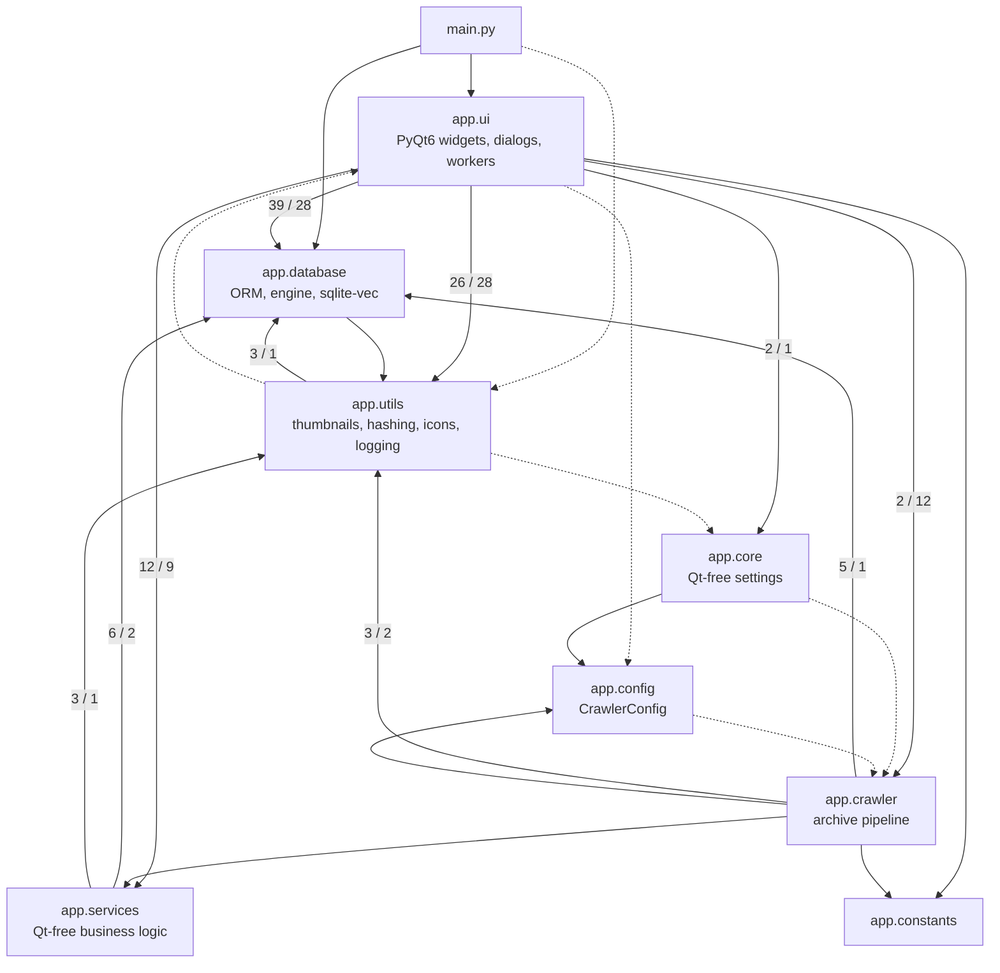
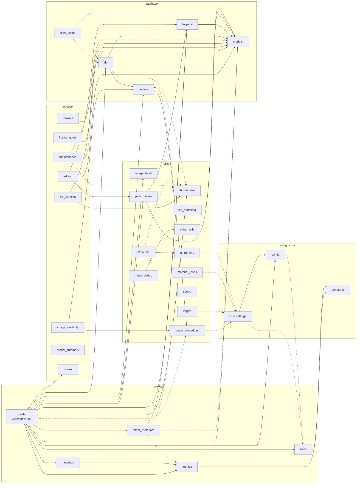
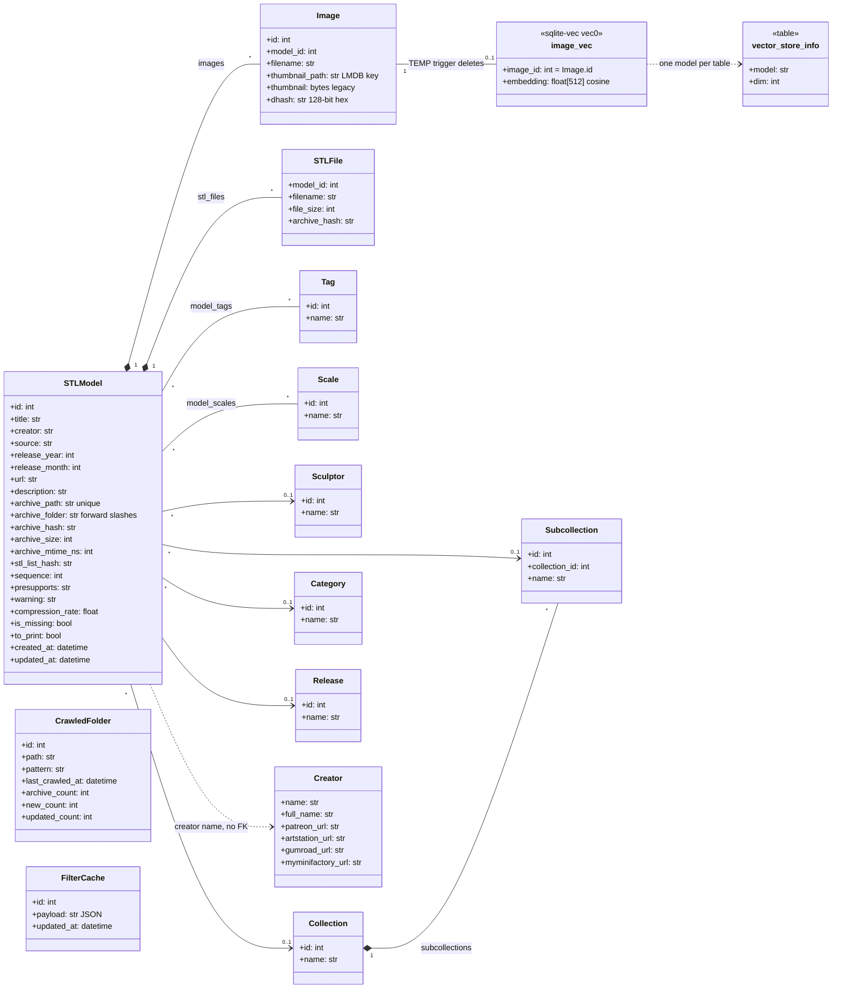
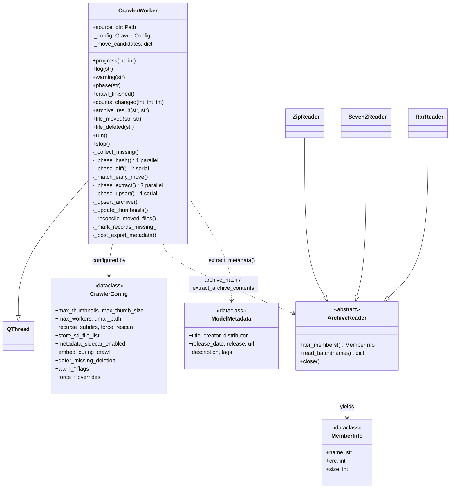
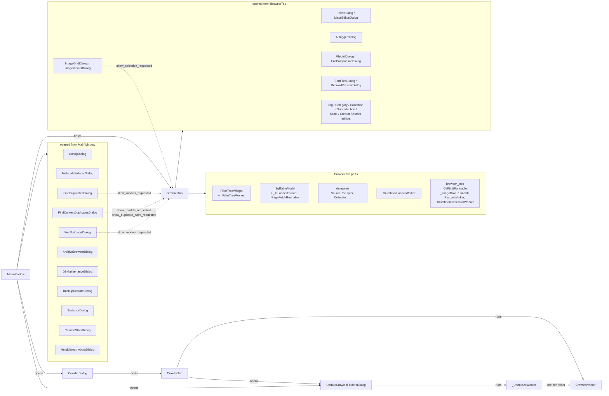
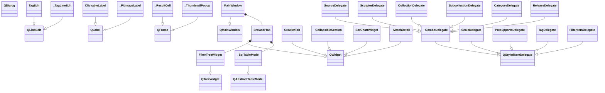
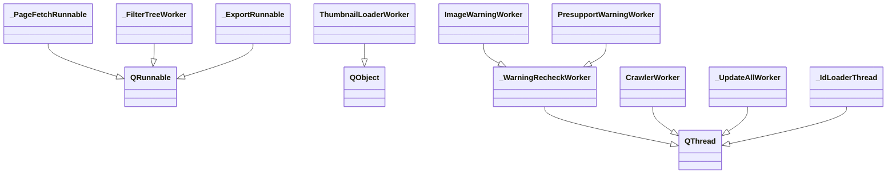

# stlLibrary — Class Structure and Dependencies

Generated on 2026-10-04 from the source tree with an AST scan (classes, base classes, Qt
signals and `app.*` imports). The diagrams use [Mermaid](https://mermaid.js.org/), which GitHub
and VS Code render.

**Reading the graphs:** `A --> B` means *A imports B at module level*. `A -.-> B` means the import
is **deferred** (inside a function), usually to break an import cycle (see
[Dependency notes](#9-dependency-notes)).

Contents:

1. [Package dependencies](#1-package-dependencies)
2. [Module dependencies (non-UI)](#2-module-dependencies-non-ui)
3. [Data model](#3-data-model)
4. [Crawler](#4-crawler)
5. [Services and core](#5-services-and-core)
6. [UI composition](#6-ui-composition)
7. [UI class hierarchy](#7-ui-class-hierarchy)
8. [Background workers](#8-background-workers)
9. [Dependency notes](#9-dependency-notes)

---

## 1. Package dependencies

Edge labels count the import statements between the two packages (module-level / deferred).

The intended layering is `ui → services → database`, with `crawler` alongside `services`, and
`core`, `config` and `utils` underneath. The UI still queries the database directly in many
places (39 module-level imports of `app.database`); `app/services` is where that logic is
being moved (see `docs/refactoring-plan.md`). The upward edges `utils → ui`, `utils → database`
and `core/config → crawler` are covered in [section 9](#9-dependency-notes).

## 2. Module dependencies (non-UI)

`services.moves` and `services.model_summary` import nothing from `app` (they work on the
session and ORM objects they are given), and neither does `utils.string_utils`.

## 3. Data model

SQLAlchemy ORM classes in `app/database/models.py`, plus the sqlite-vec table managed by
`app/database/vectors.py`. Thumbnails themselves live in LMDB (`app/utils/thumbnailer.py`),
keyed by `Image.id`.

- `*--` marks cascading ownership: deleting a model deletes its images and STL file list.
- `image_vec` is a virtual table and has no foreign key. A per-connection `TEMP` trigger removes
  a vector when its image is deleted (see `vectors.py`).
- `Creator` is matched to `STLModel.creator` by name; there is no foreign key.
- `models_view` (created in `db._ensure_views`) joins `models` with the five lookup tables for
  the browser table.

## 4. Crawler

Collaborators of `CrawlerWorker`, by module:

| Module | Used for |
|---|---|
| `crawler.archive` | `iter_archives`, `archive_hash` (CRC fingerprint), `extract_archive_contents`, `list_contents` |
| `crawler.metadata` | `extract_metadata` → `ModelMetadata` |
| `crawler.rules` | `detect_presupport`, `detect_warnings`, `detect_scale` |
| `crawler.folder_metadata` | `METADATA.7z` import before a crawl and export after it |
| `services.moves` | `index_by_hash`, `relocate`, `merge_into_missing`, `delete_model` |
| `database.helpers` | `get_or_create_*` lookups, `prune_unused_lookups` |
| `database.vectors` | storing CLIP embeddings computed during the crawl |
| `utils.thumbnailer` | batched thumbnail writes and `delete_thumbnails` |
| `utils.image_hash`, `utils.path_pattern` | dHash, `{token}` path patterns |

`CrawlerConfig` is built by `core.settings.build_crawler_config()`, so the crawler never reads UI
settings directly.

## 5. Services and core

Qt-free modules, shown as classes with the `<<module>>` stereotype listing their public functions.
`FilterSpec` and `DeletionReport` are the only real classes.

```mermaid
classDiagram
    class library_query {
        <<module>>
        +table_where(spec, view)
        +facet_scopes(spec, view)
        +search_condition(text, view)
        +conditions(spec, view)
        +path_id_select(paths)
        +prune_ancestor_paths(paths)
    }
    class FilterSpec {
        <<dataclass>>
        +include
        +exclude
        +has_value
        +no_value
        +ids
        +facet_active()
        +is_empty()
        +pruned_paths()
    }
    class editing {
        <<module>>
        +apply_cell_edit(session, model, col, value)
        +assign_tags() / assign_scales()
        +set_sculptor() / set_category() / set_release()
        +set_collection() / set_subcollection()
    }
    class lookups {
        <<module>>
        +usage_counts(session, kind)
        +usage_count(session, kind, id)
    }
    class image_similarity {
        <<module>>
        +MAX_RESULT_IMAGES = 1024
        +find_similar_models(session, vec, threshold)
        +load_model_vectors(session)
    }
    class model_summary {
        <<module>>
        +model_summary(session, model_id)
    }
    class moves {
        <<module>>
        +archive_folder_for(path)
        +relocate(model, path, hash, size, mtime)
        +merge_into_missing(session, old, new)
        +delete_model(session, model)
        +index_by_hash(missing)
    }
    class maintenance {
        <<module>>
        +verify_archives(...)
        +find_duplicate_entries(...)
        +prune_images(...)
        +compact_database(engine, path)
        +database_free_bytes(session)
    }
    class file_deletion {
        <<module>>
        +delete_archives(session, ids, use_trash, trash_path)
    }
    class DeletionReport {
        <<dataclass>>
        +deleted: int
        +failed: list
        +total()
    }
    class settings {
        <<module app.core>>
        +register_providers(...)
        +get_data_dir() / get_unrar_path()
        +get_* per-library settings
        +build_crawler_config()
    }
    class vectors {
        <<module app.database>>
        +on_connect(conn) / available()
        +ensure_schema(engine)
        +store(session, items)
        +read_all(session)
        +current_ids() / prune_orphans() / count()
    }

    library_query ..> FilterSpec : takes
    file_deletion ..> DeletionReport : returns
    image_similarity --> vectors
    settings ..> CrawlerConfig : builds
    class CrawlerConfig
```

## 6. UI composition

Who creates whom at runtime, and the signals that tie the result dialogs back to the browser.

Dashed arrows are Qt signals connected in `MainWindow` (for example
`FindByImageDialog.show_models_requested → BrowserTab.show_model_ids`).

## 7. UI class hierarchy

Widgets, models and delegates. Every dialog is a direct `QDialog` subclass; they are listed in
the table below the diagram instead of drawn.

| Module (`app/ui/…`) | `QDialog` subclasses |
|---|---|
| `config_dialog` | `ConfigDialog` |
| `crawler_dialog` | `CrawlerDialog` |
| `editor_dialog` | `EditorDialog` |
| `mass_editor_dialog` | `MassEditorDialog` |
| `ai_tagger_dialog`, `ai_setup_dialog` | `AITaggerDialog`, `AISetupDialog` |
| `db_maintenance_dialog` | `DbMaintenanceDialog` |
| `find_duplicates_dialog` | `FindDuplicatesDialog` |
| `find_content_duplicates_dialog` | `FindContentDuplicatesDialog` |
| `find_by_image_dialog` | `FindByImageDialog` |
| `archive_browser_dialog` | `ArchiveBrowserDialog`, `_ArchiveImageViewer`, `_FullImageViewer` |
| `image_grid_dialog` | `ImageGridDialog`, `_GridImageViewer` |
| `browser_dialogs` | `ImageViewerDialog` |
| `browser_jobs` | `RescanProgressDialog` |
| `file_list_dialog` | `FileListDialog`, `FileComparisonDialog` |
| `sort_dialog` | `SortFilesDialog`, `_ConfirmMoveDialog` |
| `recrawl_dialog` | `RecrawlPreviewDialog` |
| `update_crawled_folders_dialog` | `UpdateCrawledFoldersDialog` |
| `metadata_sidecar_dialog` | `MetadataSidecarDialog` |
| `backup_restore_dialog` | `BackupRestoreDialog` |
| `statistics_dialog`, `column_stats_dialog` | `StatisticsDialog`, `ColumnStatsDialog` |
| `tag_editor_dialog` | `TagEditorDialog`, `_MergeSimilarDialog` |
| `category_editor_dialog` | `CategoryEditorDialog`, `_MergeCategoriesDialog` |
| `collection_editor_dialog` | `CollectionEditorDialog`, `_MergeCollectionsDialog` |
| `subcollection_editor_dialog` | `SubcollectionEditorDialog`, `_MergeSubcollectionsDialog` |
| `author_editor_dialog` | `AuthorEditorDialog`, `_MergeSimilarAuthorsDialog` |
| `scale_editor_dialog`, `creator_editor_dialog` | `ScaleEditorDialog`, `CreatorEditorDialog` |
| `help_dialog`, `about_dialog` | `HelpDialog`, `AboutDialog` |

## 8. Background workers

Every `QThread` subclass names its result signal `<what>_finished` (never `finished`, which would
hide Qt's own; `tests/test_worker_signal_shadowing.py` enforces this). Where the logic has moved
to `app/services`, the worker only wraps the service function.

| Worker | Base | Module (`app/…`) | Result signal | Wraps |
|---|---|---|---|---|
| `CrawlerWorker` | `QThread` | `crawler/crawler` | `crawl_finished` | four-phase pipeline |
| `_UpdateAllWorker` | `QThread` | `ui/update_crawled_folders_dialog` | `all_finished` | `CrawlerWorker` per folder + `services.moves` |
| `VerifyWorker` | `QThread` | `ui/db_maintenance_dialog` | `verify_finished` | `services.maintenance.verify_archives` |
| `SearchWorker` | `QThread` | `ui/db_maintenance_dialog` | `search_finished` | relocate missing archives |
| `DHashWorker` | `QThread` | `ui/db_maintenance_dialog` | `hash_finished` | `utils.image_hash` |
| `EmbeddingWorker` | `QThread` | `ui/db_maintenance_dialog` | `embed_finished` | `utils.image_embedding` + `database.vectors.store` |
| `ImageWarningWorker`, `PresupportWarningWorker` | `_WarningRecheckWorker` | `ui/db_maintenance_dialog` | `check_finished` | `crawler.rules` |
| `DedupWorker` | `QThread` | `ui/db_maintenance_dialog` | `dedup_finished` | `utils.thumbnailer.deduplicate_store` |
| `CompactWorker` | `QThread` | `ui/db_maintenance_dialog` | `compact_finished` | `utils.thumbnailer.compact_store` |
| `CompactDatabaseWorker` | `QThread` | `ui/db_maintenance_dialog` | `db_compact_finished` | `services.maintenance.compact_database` |
| `PruneImagesWorker` | `QThread` | `ui/db_maintenance_dialog` | `prune_finished` | `services.maintenance.prune_images` |
| `FindDuplicateEntriesWorker` | `QThread` | `ui/db_maintenance_dialog` | `duplicates_finished` | `services.maintenance.find_duplicate_entries` |
| `MovedInDbWorker` | `QThread` | `ui/db_maintenance_dialog` | `moved_finished` | match missing records to re-crawled ones |
| `_ContentDupWorker`, `_ImageDupWorker`, `_EmbeddingDupWorker` | `QThread` | `ui/find_content_duplicates_dialog` | `scan_finished` | `services.image_similarity.load_model_vectors` (embedding) |
| `_SearchWorker` | `QThread` | `ui/find_duplicates_dialog` | `search_finished` | `utils.string_utils` |
| `_ScanWorker` | `QThread` | `ui/tag_editor_dialog` | `scan_finished` | `utils.name_dedup` |
| `StatsWorker` / `ColumnStatsWorker` | `QThread` | `ui/statistics_dialog`, `ui/column_stats_dialog` | `stats_ready` / `data_ready` | aggregate queries |
| `MetadataSidecarWorker`, `RemoveSidecarsWorker` | `QThread` | `ui/metadata_sidecar_dialog` | `export_finished`, `remove_finished` | `crawler.folder_metadata` |
| `_BackupWorker`, `_RestoreWorker` | `QThread` | `ui/backup_restore_dialog` | `backup_finished`, `restore_finished` | file copy |
| `RescanWorker`, `ThumbnailGeneratorWorker` | `QThread` | `ui/browser_jobs` | `finished_ok`, `generation_finished` | per-model rescan / thumbnails |
| `_InferenceThread`, `_BatchThread` | `QThread` | `ui/ai_tagger_dialog` | `tags_ready`, `completed` | `utils.ai_server` (llama.cpp) |
| `_InstallWorker` | `QThread` | `ui/ai_setup_dialog` | `install_finished` | `utils.ai_runtime` |
| `_ClipDownloadWorker` | `QThread` | `ui/config_dialog` | `download_finished` | CLIP model download |
| `_IdLoaderThread` | `QThread` | `ui/browser_table_model` | `ids_ready` | `services.library_query.table_where` |
| `_PageFetchRunnable` | `QRunnable` | `ui/browser_table_model` | (callback) | paged row fetch |
| `_FilterTreeWorker` | `QRunnable` | `ui/browser_filter_tree` | (callback) | `services.library_query.facet_scopes` |
| `_CellEditRunnable`, `_ImageDropRunnable`, `_WarningDetailRunnable` | `QRunnable` | `ui/browser_jobs` | (callback) | `services.editing`, thumbnails, warning details |
| `_ExportRunnable` | `QRunnable` | `ui/sidecar_exporter` | — | debounced `METADATA.7z` export |
| `ThumbnailLoaderWorker` | `QObject` | `ui/thumb_loader` | `bytes_ready` | LMDB thumbnail reads |

## 9. Dependency notes

Import cycles and upward dependencies found by the scan. All of them are broken with deferred
imports today, which is why they don't fail at import time.

| Cycle / upward edge | Where | Why |
|---|---|---|
| `database.vectors → utils.image_embedding` and `utils.image_embedding -.-> database.vectors` | `image_embedding._vector_store_ok()` | `is_available()` also checks that sqlite-vec loaded |
| `utils.path_pattern → database.helpers / models` | module level | path patterns write onto ORM models; arguably belongs in `services` |
| `utils.file_matching → database.models` | module level | queries models when comparing archives |
| `utils.sound -.-> ui.config_dialog` | deferred | the notification-sound settings are still UI-only |
| `config -.-> crawler.rules`, `core.settings -.-> crawler.rules` | deferred | default presupport patterns live in `crawler.rules` |
| `ui.config_dialog -.-> ui.crawler_tab` and `ui.crawler_tab → ui.config_dialog` | deferred / module level | config dialog refreshes the open crawler tab |
| `utils.* -.-> core.settings` | deferred | logger, icons, AI runtime and CLIP locator need the data directory |

Moving `path_pattern` and `file_matching` into `app/services`, and the sound settings into
`app/core/settings.py`, would remove the remaining upward edges out of `app/utils`.
